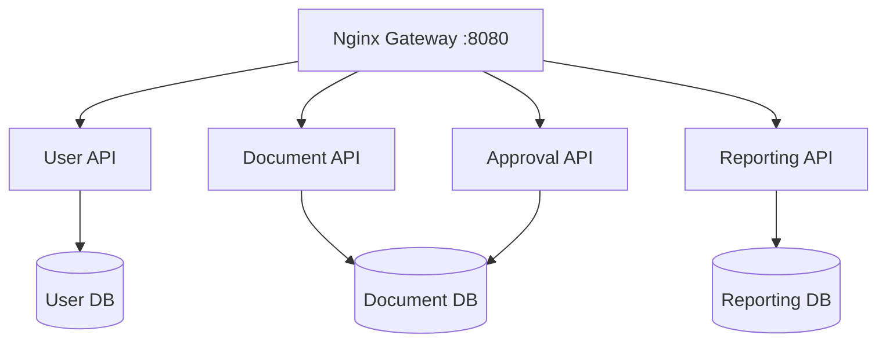

# DEKSTRA · Microservice Async

Backend administrasi desa yang memisahkan layanan akun, surat, persetujuan, dan
pelaporan. Pengiriman OTP, render dokumen, serta pembaruan dashboard dikerjakan
oleh worker Celery. **DEKSTRA Web** mengakses API melalui Nginx gateway.


## 🧩 Peta layanan



| Layanan | Tanggung jawab |
| --- | --- |
| User | JWT, OTP, registrasi, verifikasi akun, wilayah, dan penduduk |
| Document | Pengajuan, berkas persyaratan, jenis surat, dan dokumen |
| Approval | Persetujuan RT → RW → admin → kepala desa |
| Reporting | Profil, dashboard, dan notifikasi |

**Approval masih berbagi database dengan Document.** Read model dashboard diperbarui
lewat event, sehingga perubahan dapat terlihat setelah antrean diproses.

## 🚀 Menjalankan lokal

Siapkan Docker Desktop dengan Linux containers. Semua perintah berikut memakai
PowerShell dari root proyek. Python lokal diperlukan jika memakai seed data demo.

### 1. Environment dan database

```powershell
if (-not (Test-Path .env.microservices)) { Copy-Item .env.microservices.example .env.microservices }
function dc { docker compose --env-file .env.microservices -f docker-compose.microservices.yml @args }
dc build
dc up -d user-db document-db reporting-db redis
```

Tunggu sampai ketiga database menerima koneksi; ulangi pemeriksaan jika belum siap:

```powershell
dc exec user-db pg_isready -U dekstra -d user_db
dc exec document-db pg_isready -U dekstra -d document_db
dc exec reporting-db pg_isready -U dekstra -d reporting_db
```

### 2. Migrasi dan startup

```powershell
dc run --rm user-api python manage.py migrate --noinput
dc run --rm document-api python manage.py migrate --noinput
dc run --rm reporting-api python manage.py migrate --noinput
dc up -d
dc ps
```

Lanjutkan startup setelah seluruh migrasi berhasil. Migrasi Document juga
menyiapkan tabel untuk Approval dan worker dokumen. Stack lokal belum menjalankan
migrasi otomatis maupun menunggu healthcheck database.

Buka **[localhost:8080](http://localhost:8080/)**. Teks pada halaman root menandakan
gateway merespons; periksa `dc ps` dan log untuk kondisi API/worker.
Fungsi `dc` perlu dibuat lagi pada sesi PowerShell baru.

<details>
<summary>Menyiapkan akun demo dan frontend</summary>

Setelah stack berjalan, gunakan Python di host:

```powershell
python seed_dev.py --target docker
```

Skrip mengorkestrasi seed di container: penduduk, akun, profil pelaporan, dan
jenis/template surat. Akun admin contoh memakai NIK `1234567890123456` dan password
`admin`; login tetap mengikuti OTP. Seed bisa mengubah data/password akun contoh.

Di `.env.local` proyek DEKSTRA Web:

```dotenv
NEXT_PUBLIC_API_URL=http://localhost:8080
NEXT_PUBLIC_APP_URL=http://localhost:3000
```

Gunakan URL tanpa tambahan `/api` atau akhiran `/`, lalu jalankan frontend sesuai
README-nya dan periksa alur tiap peran.

</details>

## ⚙️ Pekerjaan di latar belakang

| Queue | Worker | Hasil |
| --- | --- | --- |
| `otp` | `otp-email-worker` | Email OTP |
| `document` | `document-generation-worker` | Render DOCX/XLSX, PDF, QR/signature sesuai konteks |
| `projection` | `reporting-projection-worker` | Pembaruan read model dashboard |
| `notification` | `notification-worker` | Notifikasi dari event |

Pengajuan → persetujuan → antrean dokumen → render → pembaruan laporan/notifikasi.
Keputusan persetujuan berada pada workflow; worker dokumen menangani file final.
Redis 7 menjadi broker. Container aplikasi memakai Python 3.13; LibreOffice tersedia
pada worker dokumen.

## 🔧 Referensi teknis

<details>
<summary>Environment lokal dan penyimpanan</summary>

| Variabel | Fungsi |
| --- | --- |
| `SECRET_KEY` | Secret autentikasi |
| `INTERNAL_SERVICE_TOKEN` | Token komunikasi internal |
| `OTP_EXPOSE_IN_RESPONSE` | OTP pada respons untuk development |
| `EMAIL_HOST_USER`, `EMAIL_HOST_PASSWORD` | Kredensial SMTP untuk pengiriman OTP |
| `KEPALA_DESA_NAMA`, `KEPALA_DESA_NIP` | Identitas penandatangan surat |

Konfigurasi lokal memakai debug dan pemaparan OTP. Compose hanya meneruskan
variabel yang tercantum pada blok `environment`; menambah isi file `.env` saja
belum tentu mengubah konfigurasi container. Database dan port lokal ditetapkan
pada Compose.

| Data | Lokasi pada stack development |
| --- | --- |
| Database | Volume `user_db_data`, `document_db_data`, `reporting_db_data` |
| Media pengguna | Bind mount `user_service/media` |
| Media surat | Bind mount `document_service/media`, dipakai Document, Approval, dan worker |

Cadangkan database bersama media. **`dc down -v` menghapus volume database.** Redis
lokal tidak memiliki volume persisten; antrean dapat hilang saat container dibuat ulang.

</details>

<details>
<summary>Routing API dan peta kode</summary>

| Endpoint | Service |
| --- | --- |
| `/auth/*`, `/wilayah/*` | User |
| `/pendaftaran-akun/*`, `/verifikasi/pendaftaran-akun/*` | User |
| `/pengajuan-surat/`, `/upload/berkas-surat/`, `/jenis-surat/` | Document |
| `/riwayat-pengajuan/*`, `/berkas/*` | Document |
| `/riwayat-persetujuan/*` | Approval |
| `/profil/`, `/dashboard/`, `/notifikasi/*` | Reporting |

Routing lengkap ada di `gateway/nginx.conf`; kontrak request/response di URL, view,
dan serializer tiap service. Endpoint terlindungi memakai
`Authorization: Bearer <access_token>` sesuai izin.

Folder `user_service/`, `document_service/`, `approval_service/`, dan
`reporting_service/` berisi API masing-masing. `document_generation_worker/` berisi
renderer; `shared/` berisi utilitas/kontrak event; `template_surat/` berisi template.

Baca juga: [Document](document_service/README.md) ·
[Approval](approval_service/README.md) ·
[Document Worker](document_generation_worker/README.md) ·
[Reporting](reporting_service/README.md).

</details>

<details>
<summary>Pengujian dan operasi harian</summary>

Setelah mendefinisikan fungsi `dc` dan menjalankan stack:

```powershell
dc exec user-api python manage.py check
dc exec document-api python manage.py check
dc exec approval-api python manage.py check
dc exec reporting-api python manage.py check
dc exec user-api python manage.py test registrasi
dc exec document-api python manage.py test surat
dc exec approval-api python manage.py test surat
```

Gunakan `dc stop`, `dc up -d`, atau `dc up -d --build` sesuai kebutuhan. Jalankan
migrasi jika model berubah. Test dilengkapi pemeriksaan alur login/OTP, pengajuan,
persetujuan, hasil PDF, dan pembaruan dashboard melalui gateway.

| Kendala | Periksa log |
| --- | --- |
| Gateway 502 | `dc logs --tail=100 gateway user-api document-api approval-api reporting-api` |
| OTP gagal | `dc logs --tail=100 otp-email-worker` |
| Dokumen belum jadi | `dc logs --tail=100 document-generation-worker` |
| Dashboard tertinggal | `dc logs --tail=100 reporting-projection-worker` |
| Notifikasi kosong | `dc logs --tail=100 notification-worker` |

Jika tabel belum tersedia, periksa migrasi dan kesiapan database. Untuk kegagalan
render, periksa template, media, dan log LibreOffice.

</details>

<details>
<summary>Production, monitoring, dan load testing</summary>

| Kebutuhan | Konfigurasi |
| --- | --- |
| Deployment Ubuntu | `.env.production.example`, `docker-compose.production.yml`, `deploy/ubuntu/deploy.sh` |
| Reverse proxy host | `deploy/ubuntu/nginx-host.conf.example` |
| Backup | `deploy/ubuntu/backup.sh` |
| Monitoring | `docker-compose.monitoring.yml`, `deploy/monitoring/` |
| Skenario beban | `loadtest/scenarios.json`, `loadtest/locustfile.py` |
| Runner PowerShell | `loadtest/run-scenario.ps1`, `loadtest/run-all.ps1` |
| Ringkasan dan ekspor | `loadtest/summarize-*.ps1`, `loadtest/export-results-excel.ps1` |

Setelah mengisi `.env.production`, jalankan `bash deploy/ubuntu/deploy.sh` pada
Ubuntu dengan Docker. Stack production menyediakan migrasi dan healthcheck.
Isi secret, token, password database/Redis, SMTP, domain, dan identitas penandatangan;
sesuaikan debug, pemaparan OTP, host, HTTPS, serta reverse proxy.

Monitoring memakai Prometheus, cAdvisor, dan Node Exporter dengan mount host Linux.
Port Prometheus bawaan adalah loopback 9090; metrik dikumpulkan melalui
`loadtest/collect-prometheus.ps1`.

Load test memerlukan target khusus, manifest akun, alamat metrik, dan seed yang
sesuai. `loadtest/seed_load_test.py` mengubah data dan memerlukan opsi
`--confirm-loadtest-target`; baca argumennya sebelum menjalankan. Arsip pada
`loadtest/results/` tidak mewakili performa deployment baru.

</details>
